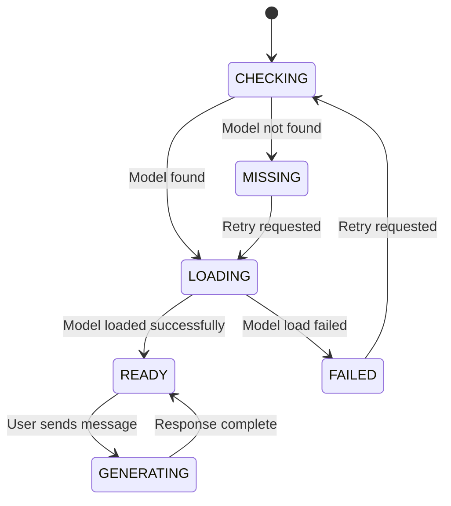

# Gemma_ChatBot_on_Android

## Overview

An Android chat bot application that runs a Gemma-4-E2B-it language model on-device using the Google LitertLM library. The application demonstrates on-device LLM inference with a conversational UI built with Kotlin Compose.

## Application Architecture

The application follows a clean on-device LLM architecture:

### Core Components

1. **MainActivity** (`app/src/main/java/com/example/gemmachat/MainActivity.kt`)
   - Entry point of the application
   - Manages model loading state and conversation flow
   - Handles user input and displays model responses

2. **Model Management**
   - Uses `com.google.ai.edge.litertlm.Engine` for model inference
   - Uses `com.google.ai.edge.litertlm.Conversation` for managing chat context
   - Model status tracked via `ModelStatus` enum: CHECKING, MISSING, LOADING, READY, FAILED

3. **UI Layer**
   - Built with Kotlin Compose
   - `ChatScreen` composable displays conversation history
   - `MessageBubble` composable renders individual messages
   - `ModelStatusCard` shows model loading/status state

4. **Data Models**
   - `ChatMessage(data class)`: Represents a message with `isUser: Boolean` and `text: String`

### Flow Diagram

```mermaid
flowchart TD
    A[App Launches] --> B{checkModel()}
    B -- Model exists --> C[Engine(modelPath) -->
    C --> D[Conversation(Config)]
    D --> E[ModelStatus.READY]
    B -- Model missing --> F[ModelStatus.MISSING]
    B -- Empty/Invalid --> G[ModelStatus.FAILED]

    style A fill:#f9f9f9,stroke:#333,stroke-width:2px
    style E fill:#c8e6c9,stroke:#333,stroke-width:2px
    style F fill:#ffcdd2,stroke:#333,stroke-width:2px
    style G fill:#ffcdd2,stroke:#333,stroke-width:2px
```

### State Transition Diagram


## Model Integration Guide

### Model Information

- **Model Name**: gemma-4-E2B-it
- **Model Format**: `.litertlm` (Google's Lightweight On-Device LLM format)
- **Model Path**: `models/gemma-4-E2B-it/gemma-4-E2B-it.litertlm`
- **Relative to**: Android app `filesDir`
- **Minimum SDK**: 24
- **Target SDK**: 36

### Prerequisites for Model Integration

1. **Add Dependency**
   ```kotlin
   // In build.gradle.kts (project level)
   litertLm = "0.19.1"
   
   // In app build.gradle.kts
   implementation(libs.litertlm.android)
   ```

2. **Model File Placement**
   - The model file must be placed in the app's `filesDirectory`
   - Path format: `filesDir/models/gemma-4-E2B-it/gemma-4-E2B-it.litertlm`
   - Model can be obtained from Google's LitertLM model repository
   - Ensure the file is readable and has non-zero length

3. **Engine Configuration**
   ```kotlin
   val modelFile = File(filesDir, "models/gemma-4-E2B-it/gemma-4-E2B-it.litertlm")
   val engineConfig = EngineConfig(
       modelPath = modelFile.absolutePath,
       backend = Backend.CPU()  # Can use GPU if available
   )
   val engine = Engine(engineConfig)
   ```

4. **Conversation Setup**
   ```kotlin
   val conversationConfig = ConversationConfig(
       systemInstruction = Contents.of("You are a helpful assistant. Keep answers concise.")
   )
   val conversation = engine.createConversation(conversationConfig)
   ```

### Running the Model

1. On app launch, `checkModel()` verifies the model file exists and is readable
2. If model is available, `loadModel()` creates an `Engine` instance
3. A `Conversation` is created with the system instruction
4. User enters a prompt in the chat UI
5. `sendMessage()` calls `activeConversation.sendMessageAsync(messageText)`
6. Response chunks are collected and displayed in the UI

## Project Structure

```
Gemma_ChatBot_on_Android/
├── gradle/                    # Gradle wrapper
├── .gradle/                   # Gradle cache
├── .idea/                     # IDE configuration
├── app/
│   ├── src/
│   │   └── main/
│   │       ├── java/
│   │       │   └── com/example/gemmachat/
│   │       │       └── MainActivity.kt
│   │       └── res/
│   │           └── (Compose UI resources)
│   ├── build.gradle.kts       # App dependencies
│   └── proguard-rules.pro     # ProGuard configuration
├── build.gradle.kts           # Top-level build configuration
├── settings.gradle.kts        # Project settings
├── local.properties           # Local SDK path
└── gradlew / gradlew.bat      # Gradle wrapper scripts
```

## Dependencies

| Dependency | Version | Purpose |
|------------|---------|---------|
| `litertlm-android` | 0.19.1 | Google LitertLM Android library for on-device LLM inference |
| `androidx.compose.bom` | 2026.02.01 | Compose BOM for UI toolkit |
| `kotlin` | 2.4.0 | Kotlin programming language |
| `junit` | 4.13 | Testing framework |

## How to Run

1. **Open the project** in Android Studio Ladybug (or newer)
2. **Ensure SDK is configured** in `local.properties`
3. **Connect an Android device** or start an emulator (min SDK 24)
4. **Sync Gradle** files
5. **Run the application** (`Run > Run 'app'`)
6. The app will automatically:
   - Check for the model file
   - Load the Gemma-4-E2B-it model on-device
   - Display the chat interface when ready
7. Enter prompts and interact with the on-device chat bot

## Model Acquisition

To use a different model or update the current model:

1. Obtain a `.litertlm` model file from [Google's LitertLM models](https://github.com/google/litertlm)
2. Place the model file at: `app/src/main/assets/models/gemma-4-E2B-it/` or in the files directory
3. Update `MODEL_RELATIVE_PATH` in `MainActivity.kt` if changing the path
4. Rebuild and run the application

## Technical Notes

- The model inference runs entirely on-device, ensuring user privacy
- Uses CPU backend by default; GPU acceleration available if supported
- Model loading may take several seconds on first run
- Conversation history is maintained in memory during the app session
- Empty or invalid model files will result in `ModelStatus.MISSING` or `ModelStatus.FAILED`